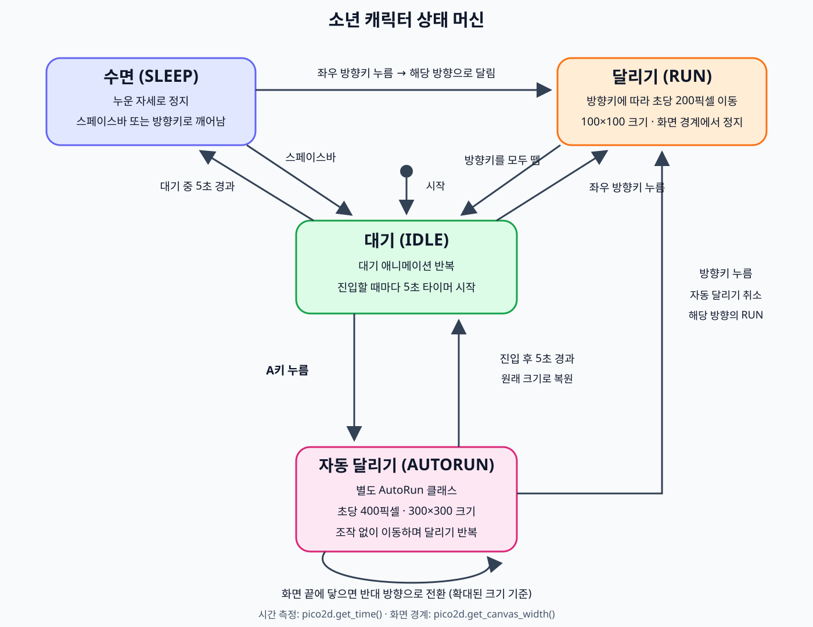

# 소년 캐릭터 컨트롤러

## 실행

```powershell
python -m pip install -r requirements.txt
python main.py
```

- 방향키: 일반 달리기. 모두 떼면 대기로 돌아갑니다.
- 대기 상태에서 5초 경과: 수면.
- 수면 중 스페이스바: 대기, 방향키: 일반 달리기.
- 대기 중 A: 자동 달리기. 3배 크기로 초당 400픽셀 이동하며 화면 끝에서 반사됩니다.
- 자동 달리기: 5초 후 대기로 복귀. 방향키를 누르면 즉시 해당 방향의 일반 달리기로 전환합니다.
- ESC / 창 닫기: 종료.

요구사항: [PRD.md](PRD.md)

## 상태 그림



## 검증

```powershell
python -m unittest -v test_controller
```

상태 전환, 5초 경계, 양끝 반사, 확대와 복원, 방향키 취소 및 기존 동작을 검증합니다.
